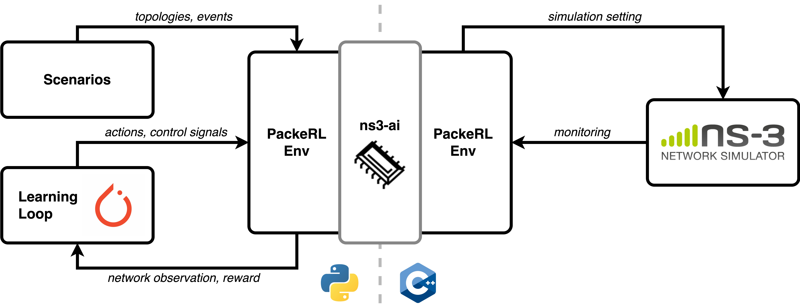
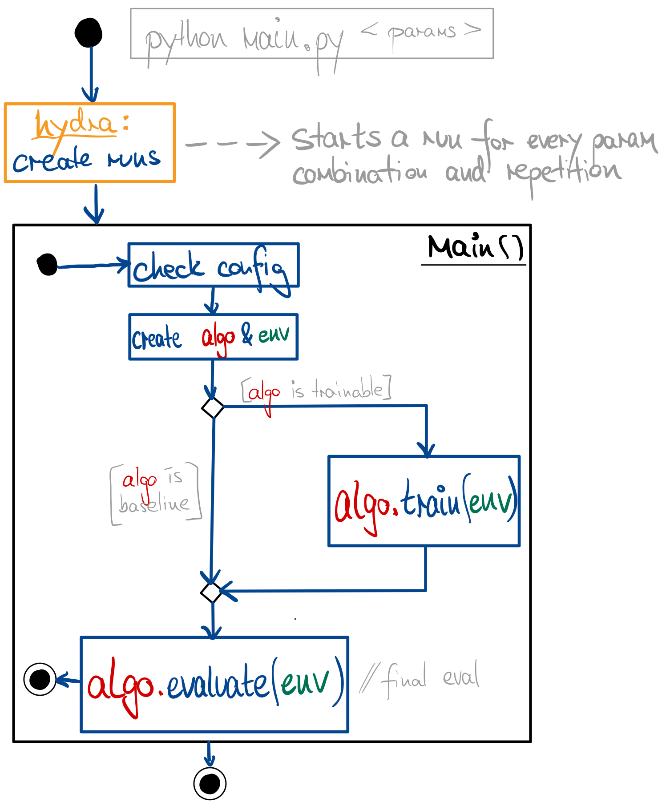
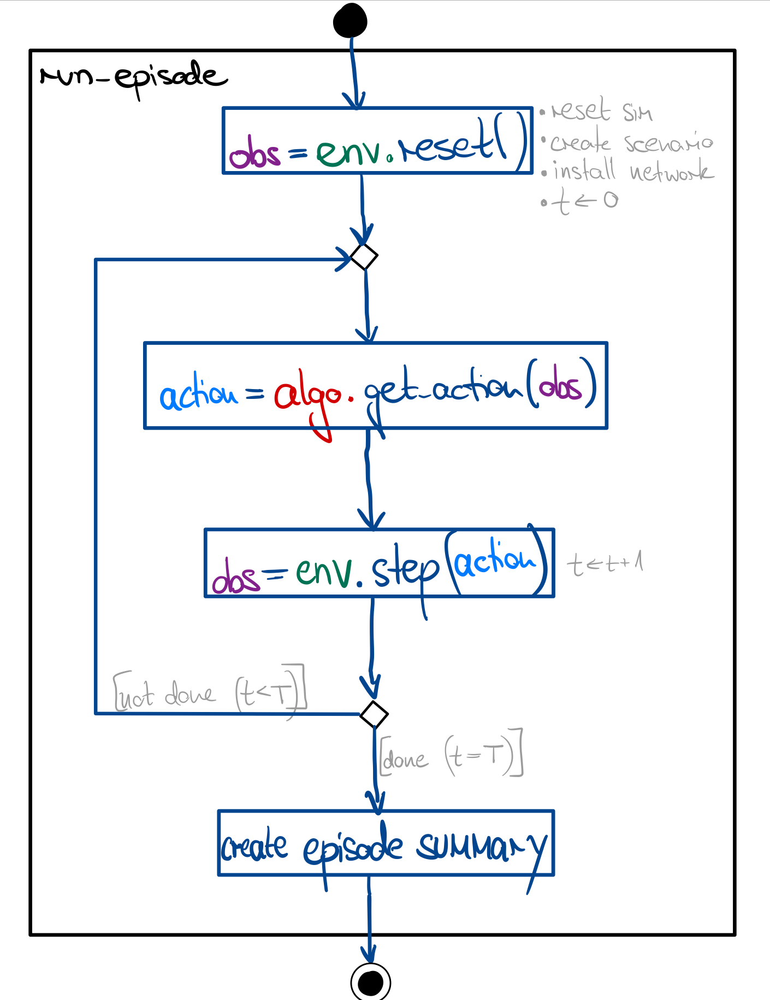
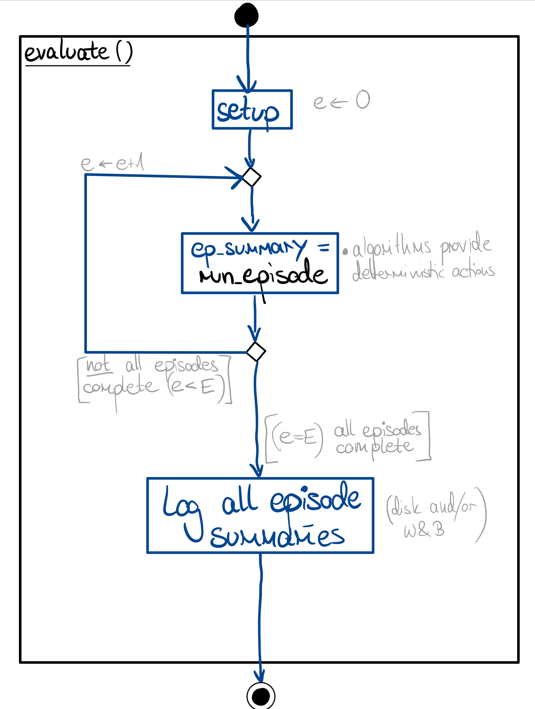
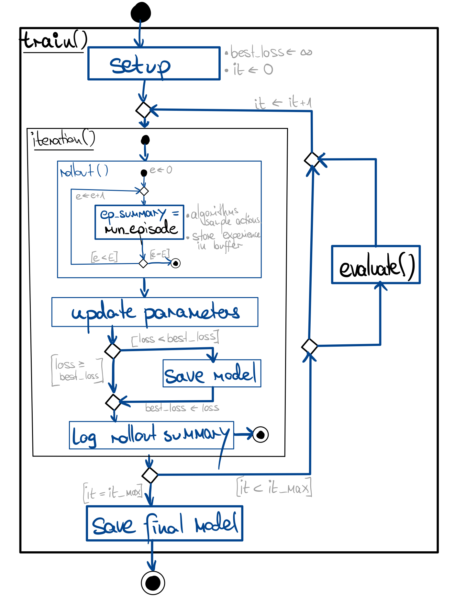

# PackeRL at a Glance

## Structural Overview



*PackeRL* is a framework to train and evaluate RL-powered routing algorithms in a packet-based environment 
leveraging the [ns-3 network simulator](https://www.nsnam.org), comparing them to traditional routing algorithms and 
other ML-based routing approaches. The main interaction with the simulation backend is realized through a two-component
environment (one component in Python - the language used for general logic and the ML components, 
and one component in C++ - the language used for the ns-3 simulator). The C++ side of the environment, together with
custom routing, monitoring and application logic as well as auxiliary classes, is situated in our own ns-3 extension
`ns3-packerl/`. The two sides of the PackeRL environment are connected
via [ns3-ai](https://github.com/hust-diangroup/ns3-ai), a shared memory interface that allows for fast communication
between the main run/learning process (Python) and the simulation process (C++). All simulation parameters, settings 
and routing actions that are played through in ns-3 are created/computed/provided by the Python side of the framework.
This includes the *network scenario* (the network topology, the traffic patterns, etc.; 
see [Section 8](08_scenarios.md) for further info), the *routing actions* (information used to populate the routing
tables of the nodes in the network; see [Section 5](05_routing_actions.md) for further info), and 
learning/evaluation-related control signals. The C++ side of the environment receives these parameters and settings,
sets up the simulation and adjusts the routing nodes' routing tables accordingly. In PackeRL, we employ a step-based
interaction between routing algorithm and network simulation: We run the simulation for a
pre-defined number of simulation steps, each comprising a pre-defined period of time, and pause the simulation 
after each simulation step to consult the selected routing algorithm for new routing actions. 
A custom ns-3 monitoring module assembles fine-grained network state information from a node-centric perspective 
that can be used to obtain new routing preferences, and it provides performance metrics as well as "rewards" 
for assessing and improving routing performance, and sends these back to the Python side of the environment.

## What Happens in a PackeRL Experiment?

### The Entry Point `main.py`



The entry point of a PackeRL experiment is the `main.py` script, invoked e.g. as:
```
python main.py <params>
```

We first use `hydra` to create unique combinations of parameters from the provided config presets
(see [Section 9](09_experimentation.md) for more details).
For each parameter combination and repetition, we enter `main()`. 
The `main()` function checks the given parameter combination for validity and sets up the PackeRL environment and the
specified algorithm to evaluate on some network scenarios. 
The algorithm may be a trainable algorithm, in which case it is trained/validated first (see below).

### A PackeRL Episode



Routing algorithms are trained and evaluated in episodes, which are defined by a number of simulation steps and 
a unique network scenario they work on (c.f. [Section 8](08_scenarios.md)). 
At the start, the environment is reset, which reset the simulation process and the shared memory instance,
generates the network scenario and installs the network topology in the simulation 
(c.f. [Section 3](03_network_model.md)). We then interact with the
simulation backend in the classical RL way: we obtain a routing action (c.f. [Section 5](05_routing_actions.md)) 
from the algorithm, install the routing actions in the simulation, and run the simulation for a predefined period 
of time. Depending on whether this is a training or evaluation episode, this may be a sampled or a determinstically 
obtained routing action. We then obtain the network state observation(s) (c.f. [Section 4](04_monitoring_observations.md)) 
and reward(s) (c.f. [Section 7](07_metrics_rewards.md)) from the simulation, pass it to the Python side,
and repeat the process until the episode is done. At the end of the episode, we assemble episode statistics to
later log the results of the experiment to disk or platforms like [Weights & Biases](https://wandb.ai/).

### The Evaluation Prodecure



An evaluation consits of multiple such episodes, which are run in the same way as described above. 
Such a process is started at least once at the end of every experiment, where we call this a "final evaluation".
Additional evaluations can be run after a configurable number of training iterations for trainable baselines. For
trainable and baseline algorithms alike, the actions are taken deterministically from the algorithm. At the end of each
evaluation, we assemble the evaluation statistics and log them to disk or platforms like Weights & Biases.

### The Training Procedure



A training process consists of multiple _training iterations_. After each training iteration, 
we store the current model if the current best training loss improved, and after a configurable number of 
training iterations we may interleave an evaluation to validate the performance of our algorithm.
Each training iteration consists of a rollout and a parameter update phase. The rollout phase consists of multiple
episodes as introduced above, where we collect "trajectories" (series of network observations, actions, and rewards) and 
algorithm-specific training information. The parameter update phase then uses the collected information to 
compute losses depending on the selected optimization criterion and the resulting reward, 
and to update the algorithm's parameters according to the losses (TODO adjust later for other algorithms).
After the training phase, we log both the rollout episode statistics and the training statistics 
to disk or platforms like Weights & Biases.