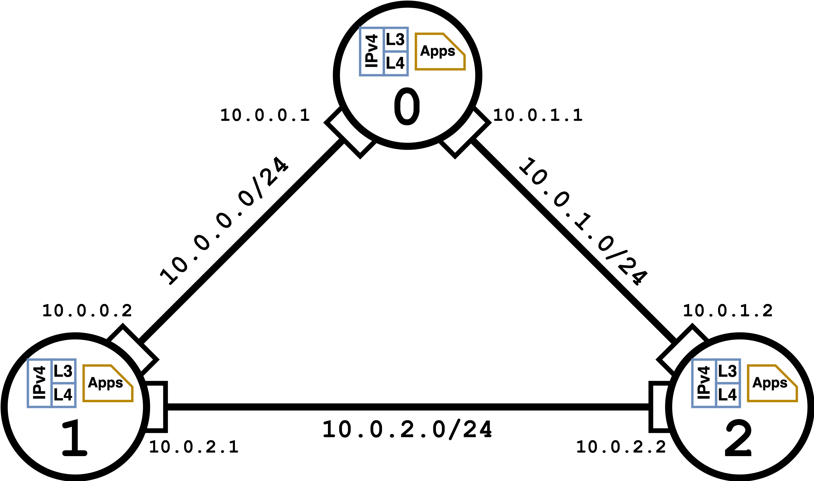

# PackeRL's Network Model

## Our Networks in ns-3

Networks in ns-3, by default, consist of nodes and links/connections between nodes. For modeling simplicity, 
we limit ourselves to connected network topologies that hold full-duplex peer-to-peer (P2P) connections transmitting 
data error-free and at a constant pre-specified datarate. Nodes themselves do not generate or consume data; 
Instead, applications are installed on nodes that generate data destined for other applications, 
or consume the data that is destined for them. To transport data between nodes we install an _Internet Stack_ 
on top of each node, adding IPv4 and TCP/UDP components in a way that mimics the OSI reference model. Each node sets up
a packet sink application for UDP traffic, and one for TCP traffic, which are used to receive data sent by other nodes.
The sender applications are created on-demand as traffic flows arrive (c.f. [Section 8](08_scenarios.md)). 
UDP flows use an `OnOffApplication` sending constant bitrate traffic, and TCP flows use a `BulkSendApplication`; both
applications are installed on the nodes that are the source of the traffic and set to deactivate themselves 
when the specified amount of data has been sent. The sending datarate for UDP traffic is set depending on the
size of the traffic flow (1 Gbps for flows <100KB, between 1-5Mbps for >100KB), 
while TCP applications adjust their sending rate dynamically based on the congestion control
algorithm in use (we use ns-3's default TCP CUBIC). Nodes do not put data stemming from applications 
on the P2P link themselves, or read data from it. This is done by the network devices 
(rectangles attached to the nodes in above figure) that belong to a P2P connection, which are installed as interfaces 
on the two nodes that are being connected. Each network device holds a packet buffer set to the bandwidth-delay product
of (datarate x 2 x link delay). Upon installation of the Internet Stack, the P2P connection between 
two nodes is assigned an IPv4 address space, with concrete IPv4 addresses given to the incident network devices. 
Each node keeps track of the IP addresses of the network devices that are connected to it 
(the first IP address however is the node's loopback address). Furthermore, for convenience, we hold a global mapping
from IP addresses to node IDs, which is used to identify the source and destination of data packets since, in reality,
data packets are sent to IP addresses, not node IDs. This means that we assume IP addresses to be unique 
across the network, and that nodes are not allowed to change their IP address during the simulation run.

## PackeRL's take on the Network Model

In real-world computer networks, of course, nodes are not only connected via P2P links, 
data is not always transmitted error-free or at a constant datarate, and the applications generally don't run on the 
nodes themselves but on hosts and servers that are connected to the network routers and switches. We use the simplified
model of P2P links forming pairwise connections between nodes that are senders, receivers and forwarders of data 
at the same time. This way, we can formalize routing optimization in computer networks as a problem on the domain of
graphs with node, edge and global attributes without parallel edges. In our abstracted network model, 
nodes are responsible to route data to other nodes such that data travels from source to destination node in a most 
optimal way (c.f. [Section 7](07_metrics_rewards.md) for a discussion of routing 'optimality' in the context of PackeRL).
This formalism permits multiple deployment modes for reinforcement learning agents: In the single-agent case,
one of the network's nodes or a conceptual 'birds-eye' node is the agent that adjusts the routing tables of all nodes
in the network, while in the multi-agent case, each node is an independent agent that adjusts its own routing table.