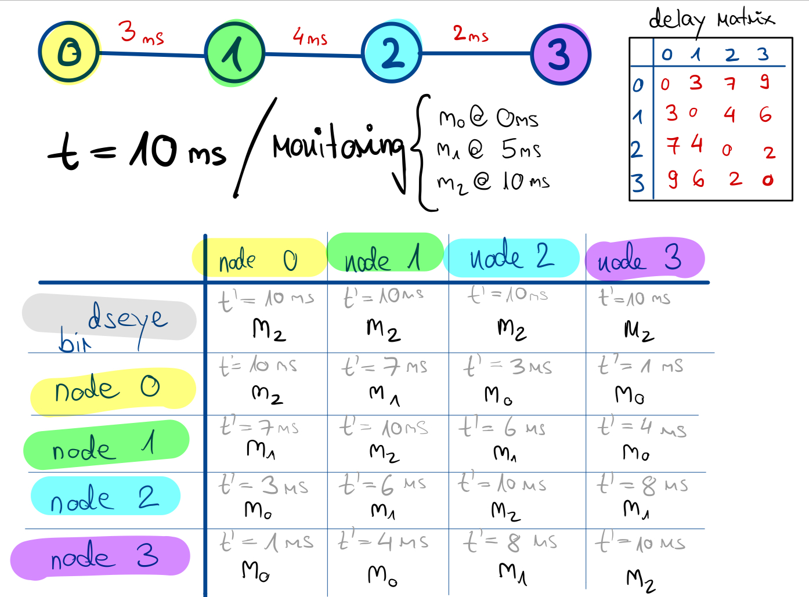
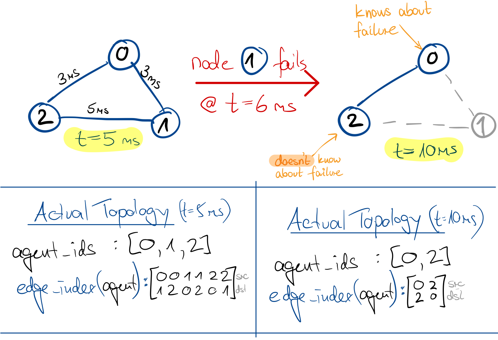
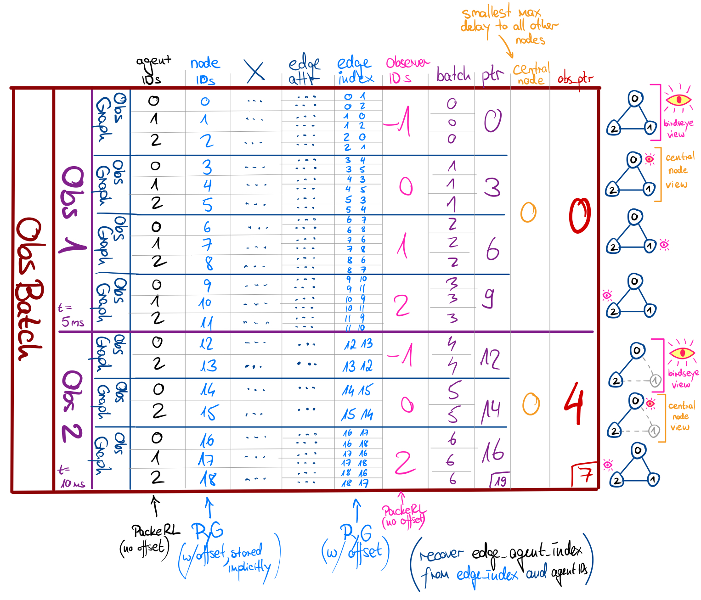

# Monitoring and Observations

## Network Monitoring in PackeRL

In order to efficiently obtain the state of the computer network, we utilize the In-Band Network Telemetry capabilities 
provided by ns-3's `FlowMonitor` module 
(Carneiro et al.: _"Flowmonitor: A Network Monitoring Framework for the Network Simulator 3 (ns-3)"_).
It utilizes probes installed on packets to track per-flow statistics such as traffic volume, 
average and maximum packet jitter/delay, and node-level routing events down to the \gls{ip} level.
Additionally, we track packet-level events such as packet drops, queueing events, forwarding decisions,
retransmissions, and reception of packets for each packet ourselves. This allows us to obtain a detailed view of the 
network state globally, per node and per edge (2 directions per full-duplex P2P link). 
Consequently, these states include the amount 
of data sent, received, dropped and in-flight, packet buffer fill information, flow-specific measures, 
and many other quantities. We manage the monitoring of the entire network state in a centralized manner from a 
single class, our `PackerlMonitor`. It uses `MonitoringNode` and `MonitoringEdge` objects to track the state of 
nodes and edges, respectively.

At the end of each timestep, we use the tracked events and flow statistics to create "snapshots" of the network state.
Network states generally are attributed graphs that contain node-level, edge-level, and global information.
The events tracked by `PackerlMonitor` do not happen "globally", but rather at a specific place and point in time.
Therefore, if we simply put all tracked information into a single attributed graph, we end up with a network view 
"from above" that contains all information about the network at time of snapshot creating, 
but disregards the delay that would arise when communicating localized monitoring information between nodes. We call 
this the "birdseye" view of the network state and provide it as a kind of "global" network state.

### Local Network State Views

With aforementioned "birdseye" view of the network state, we can already do routing optimization experiments 
using centralized algorithms or single-agent reinforcement learning policies. Yet, this view ignores the communication
delay that would arise when nodes communicate their local monitoring information with each other, because events
happen at specific nodes or edges at specific points in time, and not globally (c.f. [Section 06](06_communication.md)).
For a more realistic implementation of the network routing problem, we need to consider this localized nature of 
monitoring information. Specifically, we assume events to happen at nodes or edges: If they happen at nodes, that node
received the monitoring information connected to the event, e.g. a packet drop or reception; if they happen at
edges, we assume the incident node to register the event instantly, i.e. the sender of a packet that was dropped
in the network device/channel registers the drop event, or the intended receiver of a packet that was dropped in
reception registers the drop event. This means that each node in the network only has an up-to date view of what 
happens at itself, which we call a `NodeSnapshot`. 
Nodes can however obtain a "local" view of the entire network state by communicating their
snapshots with other nodes. A possible naive implementation would be to send one's own snapshot to all neighbors, 
which then propagate this snapshot further. In reality, this snapshot communication would probably run over 
the same network infrastructure that does the "main" data transport, and therefore the communication would incur an
unpredictable delay depending on the current "main" network traffic. 

Due to the complexity such an implementation would incur, we simplify the network snapshot communication 
between nodes by assuming a fixed pairwise communication delay between each pair of nodes calculated from the 
(static) delay values of the unterlying network topology. This pairwise delay "lower bound" is the result of
an all-pairs-shortest-paths calculation using the link delays. Above figure shows an example on how we obtain local 
network views from node snapshots: Let's assume we are at t=10ms, with node snapshots obtained every 5ms. 
Naturally, the "birdseye" view of the network state at t=10ms would consist of the snapshots of all nodes at t=10ms. 
For the local network view from node 1 (red numbers in the figure), 
we would "subtract" the respective pairwise communication delay from node 1 
to all other nodes from the current snapshot time (t=10ms). This, for example, yields t'=4ms for node 3. Node 1
would receive the latest snapshot of node 3 available at t'=4ms, which is the snapshot obtained at t=0ms. 
Node 3, on the other hand, would of course use its own snapshot at t=10ms but the latest snapshot of node 1 
available t'=4ms, which is the snapshot obtained at t=0ms. Note that adjustments to the network topology are also
results of local events (c.f. [Section 08](08_scenarios.md)) and would therefore take time to reach more distant nodes,
too. Consequently, while the "birdseye" view of the network state always contains the latest snapshot of all nodes 
**and** the latest network topology, the local network views of nodes may contain outdated network topologies and
state information (see example graph below, where node 2 would still hold the outdated topology with node 1, whereas
node 0 would have noticed that node 1 has failed and would therefore not include it in its local view).

## From Monitoring Snapshots to Network Observations

_Note: In our network model described in [Section 03](03_network_model.md), routing "agents" either sit 
on one network "node", or on every node of the network. While we have used the terms "node" and "agent" interchangedly 
up to here, we have to distinguish them in the context of observations and observation graphs: While the IDs of routing
agents may be non-contiguous due to node failures, the IDs of nodes in PyTorch Geometric graphs need to be contiguous.
Consequently, we refer to "agent" when talking about the actual "routing" agents/nodes in the network, 
and to "node" when talking about the "inner" nodes in the PyTorch Geometric graphs._

The result of the monitoring process is a set of N+1 attributed graphs, 
one per active agent plus a global "birdseye" view (see above). 
We place these graphs into the shared memory and read the data on
the python side, bringing it into the [PyTorch Geometric (PyG)](https://pytorch-geometric.readthedocs.io/en/latest/get_started/introduction.html) ecosystem: 
For each of the N+1 attributed graphs,
we'll find node-specific features in the node attributes `x` (shape: [num_nodes, num_node_features]), 
edge-specific features in the edge attributes `edge_attr` (shape: [num_edges, num_edge_features]),
and global features in the graph attributes `u` (shape: `[num_global_features, 1]`).
In addition, the connectivity of the attributed graphs is represented by the edge index `edge_index` (shape: [2, num_edges]).
For Graphs in Pytorch Geometric, node IDs need to be consecutive integers starting at 0, which may not be the case
in our attributed graphs (due to e.g. node failures). Therefore, we provide an additional tensor `agent_ids` (shape: [num_nodes, ]) 
that contains the unique IDs of each routing node/agent in the computer network. 
This `agent_ids` tensor is used throughout the code to map the "outer" agent IDs to the "inner" node IDs 
used in the PyG graphs. Each of these attributed graphs is from the perspective of a single agent 
or the global "birdseye" view, and we call this the "observer" of that graph. 
We supply the agent ID of the observer in the graph attribute `observer_ids` (shape: [1, ]) and reserve a special value for
the 'birdseye' observer. Throughout the code, we will use the 'birdseye' observation graph, if not for actual routing
action inference, for special computations such as recomputing the pairwise communication delays or determining the
most "central" node in the network (the node with the lowest maximum pairwise communication delay to all other nodes). 
All of this information is used
to create an instance of the `ObservationGraph` class, which is a subclass of PyTorch Geometric's `Data` object that
comes with additional logic required for the RL part of PackeRL.

Having created the `ObservationGraph` instances, we can create full "observations" of the network state as a `Batch` of
`ObservationGraph` instances (see PyG [Batching](https://pytorch-geometric.readthedocs.io/en/latest/get_started/introduction.html#mini-batches)). 
`Batch` objects treat all the information of the individual `ObservationGraph` as a "single" graph, using internal
counters and offsets to keep track of the individual graphs in the batch and enable efficient processing. We create
our own `Observation` class as a subclass of PyG's `Batch` that contains additional logic to e.g. get specific graphs
by observer ID, to get "outer" agent IDs or inner node IDs with or without index offsets, 
or to get special views of the network observation as an input to policies and value functions.
Additionally, we limit the assembly/disassembly of `Observation` objects to only accept and provide 
`ObservationGraph` instances, and supply the central node obtained by the 'birdseye' graph as an additional attribute.

Finally, for RL algorithms, we normally require batches of observations. Since our observations are already batches of 
graphs, this would require a complex second-order batching. In our `ObservationBatch` class, 
we simplify the modeling by batching over the individual observation graphs of the `Observation` instances, 
with `ObservationBatch`-specific pointers `obs_ptr` to keep track of which `ObservationGraph` belongs 
to which `Observation`. This means that both `Observation` and `ObservationBatch` are batches of `ObservationGraph` 
instances, but that accessing these instances is done on the level of individual graphs or observations, respectively.

Above figure illustrates a complete `ObservationBatch` with 2 `Observation` instances, 
counting 7 `ObservationGraph` instances in total (4 for the first observation, 3 for the second). It builds upon the 
example graph shown in the previous figure, where agent 1 fails in between the snapshots of the first and second 
observation. Note that the batching of Pytorch Geometric shifts the `edge_index` for parallel processing, whereas our
`agent_id` and `observer_id` tensors remain unshifted. We can recover both the inner node IDs and the outer agent IDs
with or without the batching offset (all variants are required in the PackeRL code, e.g. for batched operations, 
masking, shortest path calculation etc.)