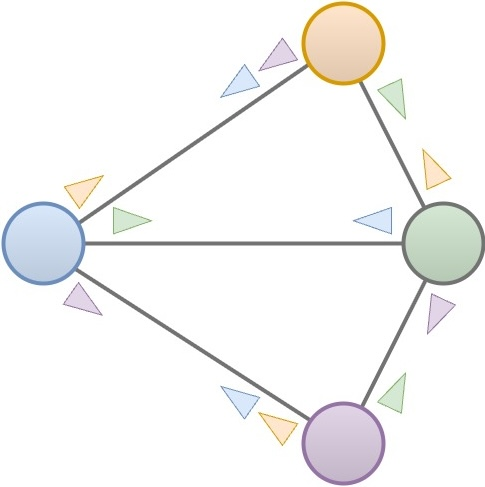
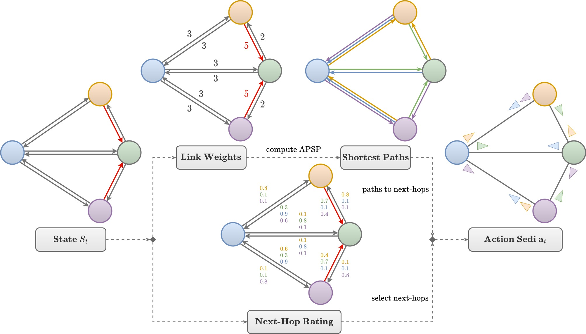
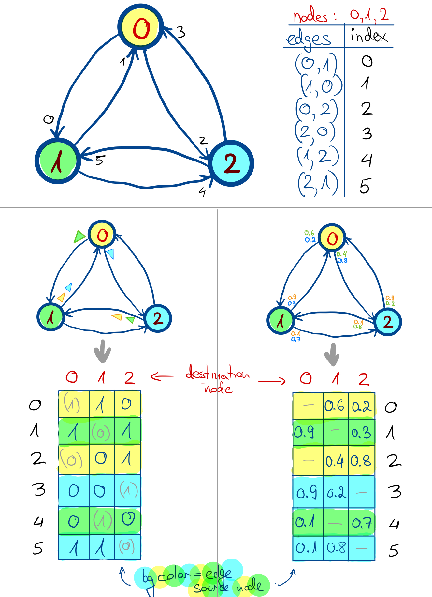

# Action Space Design

Routing in computer network involves two primary tasks: determining the best paths and forwarding the
packets along these paths. For the latter, routers keep a set of routing rules in their memory. Each rule
specifies a next-hop neighbor to which packets with a certain destination are to be forwarded. This rule set -
also known as a routing table - gets populated by the installed RP, and we adopt this mechanism for our
work. Most contemporary IP networks employ destination-based routing, i.e. routers forward packets by
finding the routing table entry that matches the packet’s destination address, and sending the packet to the
next-hop neighbor specified in that entry. For PackeRL, we adopt the commonly used forwarding
mechanism using routing tables stored in the router’s memory that may get updated by the routing algorithm. 
Therefore, regardless of the routing action’s representation, we need to convert it into a set of routing table rules 
for each concerned routing node. In PackeRL - for now - we limit ourselves to deterministic unicast routing, 
such that each routing table rule contains one next-hop neighbor preference for a given destination IP address 
(recall that we keep a global mapping of IP addresses to routing nodes for convenience).

In our C++ environment, we use a custom `ns3::OddRouting` routing protocol that allows the installation of the provided 
routing next-hop preferences onto the network nodes. Since not all node pairs in a network necessarily communicate 
with each other, the `OddRouting` module stores the received routing preferences in a separate location 
on the routing node, and only fills the nodes’ routing tables on-demand once a packet arrives at a node 
for which no suitable routing rule exists in its routing table. All subsequent packets destined 
for the same target node will have access to the newly installed table entry until the start of a new timestep, 
when new routing preferences will be stored in the node and its routing table will be flushed. This ensures that
we keep the "line-speed" capability of the forwarding plane, while still allowing the routing algorithm to
update the routing preferences based on the current network state. Therefore, we designed `OddRouting` to resemble 
the other IPv4 routing protocols implemented in ns-3, except for the updating of routing rules once every timestep 
and the population of routing tables from these rulesets on-demand.

## Selected Edge Destination Indices (Sedi) - An Unanimous Action Design for Deterministic Unicast Routing

In our framework, for deterministic unicast routing, 
we can map the routing table rules to selected next-hop edges per destination node 
for each routing node in the network graph. Because we can order the edges and destination nodes in a fixed way, 
we can represent the possible next-hop edges as a tensor of "edge destination indices", where each combination of 
edge + destination node is assigned a unique index (i.e. E*N indices in total). From these indices, we can obtain a 
routing "action" by selecting next-hop edges per destination node at every routing node (`num_nodes ** 2` entries).
We call these values the "selected edge destination indices" or "sedi".

Above figure illustrates the action sedi for a simple network with colored nodes: The colored arrows next to the
edges show that this edge has been selected for routing packets destined for the respectively colored destination node. 
Note that above figure shows 12 arrows even though N^2=16. This is because next-hop decisions for traffic that already 
is at its destination are irrelevant (and thus not shown in the figure). 
Such packets are processed locally by the node and don't need further routing.

## From Network Observations to Action Sedi

As explained in [Section 04](04_monitoring_observations.md), by default, we represent the network state and the observations
of the routing nodes as graphs with node, edge and global attributes. The above figure shows that we currently 
conceive two ways to convert the observations into action sedi: To compute shortest paths and use the resulting 
next-hop edges, or to compute next-hop "ratings" for each edge and destination node pair, and select next-hop edges 
based on these ratings. For the first approach, we use the Dijkstra algorithm to compute the shortest paths from
weights that are computed by the routing algorithm. Depending on the algorithm, the weights for the shortest-path 
computation or the next-hop ratings may be computed simply from topology attributes like link datarate and/or delay, 
or they may be the result of a neural network pass taking the attributed graph as input.

Note: In practice, within PackeRL's Python interaction loop, an "action" consists of not only the action sedi, 
but also something we call "raw actions". These are the actual result of the respective routing algorithm prior to 
sedi conversion, e.g. next-hop preferences or link weights.
We pass them to the evaluation loop for visualization purposes, 
to the environment in case they specify link weights,
and to the experience buffer in case of RL-based algorithms, because it is the policy's actual neural network output 
we need for RL training.

## From Action Sedi to Routing in ns-3

We originally set out to support probabilistic routing/next-hop splits in addition to deterministic routing
actions. This is not fully implemented as of now, but parts of the implementation are in place. Therefore, the
actual representation of the routing actions as they are communicated from the Python to the C++ side is **different** 
from the action sedi: it is a tensor of shape `[num_edges, num_nodes]`, where each entry is a real number from `[0, 1]` 
representing the probability of selecting the edge `e` for the destination node `n`. 

Once action sedis are passed to the PackeRL environment for the upcoming simulation step, 
it first converts the received action sedi into above 
representation, which is possible because both use the same unanimous edge and node ordering of the 
underlying network observation (generally, edges are sorted by source node then destination node ID).
Since action sedi describe deterministic routing choices, their entries will translate to values of 1, 
while remaining entries will be 0. Note that, in this design, future probabilistic routing policies would output 
a tensor of shape `[num_edges, num_nodes]` with values in the range `[0, 1]` directly, 
representing the probability of selecting the edge for the destination node. Above figure illustrates this
design on an example ring topology with 3 nodes: We have six edges with unique IDs, and three destination nodes marked
in distinct colors (see upper part of the figure). The lower part shows two examples for conversions to action tensors, 
once for action sedi (lower left, sedi illustrated by colored arrows) and once for theoretical routing probabilities
per edge per destination node (lower right, probabilities in the colors of the traffic destination node). 
The sedi/probabilities are converted to values in the below action tensors (tables on the bottom of the figure), where
we've marked the respective edge source node (i.e. the routing node taking the next decision) in its respective color.
The action sedi translate to values of 1 for the selected edges (row) per traffic destination (column) 
and 0 for the remaining edges, and across all edges originating from the same routing node 
(indicated by the background colors) the values should sum to 1 for each traffic destination node.
This is the case also for the probabilistic example on the right. The values marked in grey are entries corresponding 
to next-hop preferences for traffic that already is at its destination. Because such packets are processed locally 
by the node and don't need further routing, the values marked in grey may be
filled e.g. with random choices (left) or any value at all (right).

The action tensor is then converted to a list of `RoutingActionComponents` to be sent to the C++ side. 
Each `RoutingActionComponent` contains the edge source node, the edge destination node, 
the traffic destination node for which the edge is consulted,
and the value/probability of selecting the edge for that destination (recall that for the deterministic case, 
this value is either 0 or 1). On the C++ side, we put this list of components into maps from
destination node to outbound network interface (i.e. the next-hop edge), one map for each routing node. 
Each node receives its own map at the start of the next timestep, 
and transfers the entries to its actual routing table whenever a packet arrives at the node
for which no suitable routing rule exists in its routing table. 
For this mechanism to work, we created a custom `ns3::OddNode` node subclass that supports updatable routing maps with 
on-demand transfer to the routing table. This class allows `OddRouting` 
to install the provided routing next-hop preferences onto the nodes on-demand.