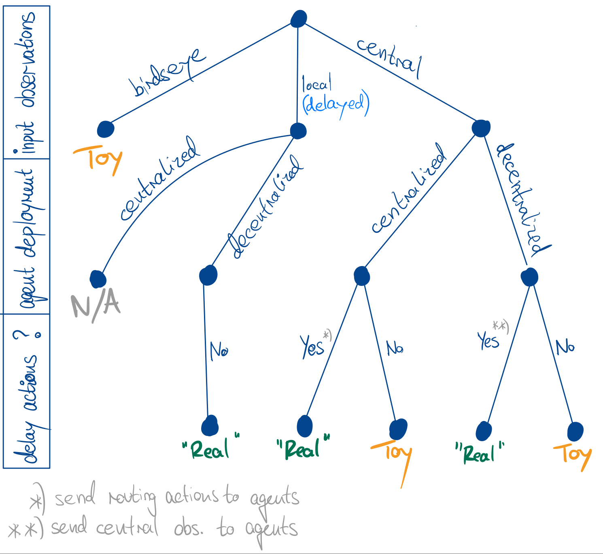

# Communication and Routing Algorithm Deployment

Routing optimization in computer networks is a time-critical task that may benefit from fast and efficient routing 
updates given the current network state. As we abstract from real-world networks to simulation and 
separate the simulation backend from the decision-making logic, we need to consider how communicating network state
information, routing actions and control signals between the Python side of the framework and the C++ simulation
works and influences the routing algorithm performance (and thus our findings).

## Shared Memory Interaction

We use ns3-ai (Yin et al., 2020: "Ns3-Ai: Fostering Artificial Intelligence Algorithms for Networking Research") 
to create a shared memory structure that allows us to communicate data between the Python side of the framework
(data/scenario generation, training and evaluation loop, main process etc.) and the C++ side of the framework
(ns-3 simulation backend incl. PackeRL extension module). For this to work, we need to ensure that the shared memory
block is properly initialized and that both the Python and C++ sides define data structures that are of the same
size, structure and alignment, adding up to a consistent view of the shared memory block. 
Note that we use [our own fork of ns3-ai](https://github.com/geometric-networking/ns3-ai) 
to add custom memory block interaction features required for PackeRL.

_(In the meantime, the API has changed significantly, and re-aligning our code with the latest version of ns3-ai
is in our backlog.)_

### Shared Memory Details (Optional Read)

The structs used for passing data between the Python and C++ sides are defined in `utils/shared_memory/structs.py` and
`ns3-packerl/utils/shared-structs.h`, respectively. The Python side uses the `ctypes` module to define structs that
match the C++ side, and a custom context manager that ensures that the shared memory block is properly accessed in a 
pre-defined amount of time, raising an exception if the access times out. Access logic is implemented in 
`utils/shared_memory/interaction.py`, and conversion from structured data to datatypes such as PyTorch tensors or
NumPy arrays is implemented in `utils/shared_memory/conversion.py` for more complex data types. On the C++ side,
all logic for reading and converting data from the shared memory block is implemented in the environment class
`ns3-packerl/packerl.cc` directly.

The shared memory pool is created at the start of an experiment and concrete memory blocks created at the start of
an episode via `env.reset()`. The size of the memory block has to be known in advance, and therefore we have to specify
a fixed number of elements for all the different data types that we want to pass between the Python and C++ sides.
Since, however, the number of elements can vary between different network scenarios, the shared memory access 
implemented in the files mentioned above works with an iterative mechanism: For every data type 
(e.g. `LinkFailureEvent` or `RoutingActionComponent`), we communicate how many elements of that type
will be passed in the current interaction as an additional data type of the shared memory block. Using these element
counts, the reading and writing logic can then iterate over the respective fields 
and access the correct number of elements, yielding to let the other side send more data until all elements have been
sent, received and consumed. While this may increase the amount of access/yield cycles between the Python and C++ sides,
it allows us to use a fixed-size memory block and still pass a variable number of elements of different data types.

## Routing Deployment and Communication Delays

PackeRL is implemented to support both centralized and decentralized routing algorithms. Centralized routing
algorithms receive a single observation of the network state and compute routing preferences for all nodes in the
network at once. This single observation may be the 'birdseye' observation or the observation of the central node,
and both are accessible from a provided `Observation` object (c.f. [Section 04](04_monitoring_observations.md)).
On the other hand, decentralized routing algorithms receive a local observation of the network state 
for each observing node and compute routing preferences for each node individually.
In any case, since the interaction between the routing 
algorithms (on the Python side) and the simulation (on the C++ side) relies on a single shared memory block, we supply
routing actions for the entire network in a single interaction process, 
and so we need to "assemble" a single package of routing actions for the entire network 
in case we use a decentralized routing algorithm.

By default, this centralized communication procedure via our shared memory block ignores delays 
that would incur in real-world settings when communicating information across the network. 
Ignoring the installation of routing actions in routing tables once the "content" has already 
reached the respective routing node, The realistic setting would require respecting the delays 
incurred by following tasks:
- in centralized routing settings: assembling network monitoring information in a single place, doing the inference
  to obtain routing actions, and then communicating the routing actions back to the individual nodes.
- in decentralized routing settings: communicating local observations of the network state to the individual nodes 
  (those can however work with outdated information in the meantime) and doing the inference.

As mentioned in [Section 04](04_monitoring_observations.md), this communication would incur delays with complex patterns 
since we would use the same network for communication and routing. Therefore, we include another layer of abstraction
and consider pairwise communication delays between the nodes in the network obtained by delay-based shortest-path
computation. We already include these delays in the supply of local observations to routing nodes in the decentralized
setting, but we don't include them yet for routing settings that use the 'birdseye' observation 
or the central node observation. Here, including an artificial "action delay" can help to respect the time it would take
to assemble/use centralized network information and communicate routing actions back to the individual nodes (The
implementation of action delays is left for future work). 
Assuming that delaying observations/actions by 'flat' communication delays is equal to actually communicating them via
the network infrastructure, and disregarding the time spent on inference and action installation, 
above figure shows the situations in which a deployment configuration can be considered "realistic": 
The 'birdseye' observation is a construct that is not available in real-world networks, and so
any deployment that uses it can be considered "unrealistic" in the sense that it does not respect the communication
delays for observation exchange. Using our local observations with pairwise communication delays already "baked in", 
we can consider the deployment "realistic" for the case of decentralized deployment 
(a centralized deployment doesn't make sense in this case). 
Finally, when using the observation of the most central node (the one with minimum max communication delay), we can
achieve a "realistic" deployment by adding an artificial action delay. This delay either makes up for the time spent on
communicating the central node observation to the individual nodes (in case of decentralized deployment), 
or for the time spent on distributing the routing actions to the individual nodes (in case of centralized deployment).