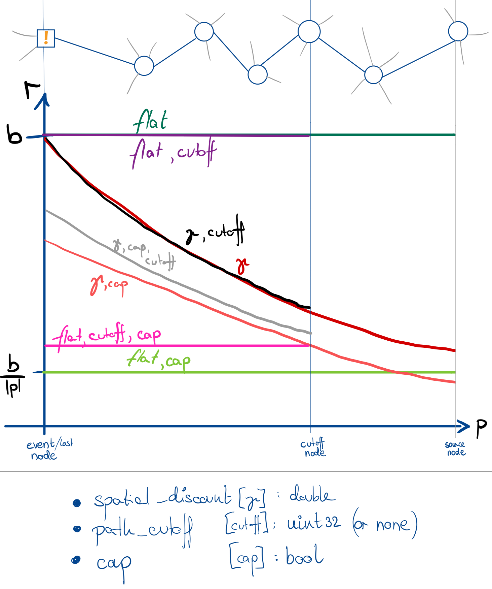

# Performance Metrics and Rewards

## Metrics 

Several concrete network performance indicators exist that could be used to gauge the 'quality' of a routing algorithm:
- *throughput* (the bitrate of all traffic flowing through links, incl. metadata), 
- *goodput* (the bitrate of traffic payloadf flowing through links, i.e. "useful" data), 
- *received* (the rate of useful data received at the destination)
- *latency*/*delay* (the time it takes for data to travel from the source to the destination),
- *packet loss* (the percentage of data that is lost during transmission),
- *packet jitter* (the variability in packet arrival times, which can affect the quality of 
  real-time applications or lead to out-of-order data arrival).
- *flow completion time* (the time it takes for a flow to be fully transmitted and acknowledged),

Additionally, more abstract performance metrics can be considered, such as:
- *fairness* (how evenly resources are distributed among competing flows),
- *congestion* (the state of the network when it is overloaded, leading to increased latency and packet loss),
- *scalability* (the ability of the network to handle increased traffic without performance degradation),
- *robustness* (the network's ability to maintain performance in the face of failures or unexpected conditions),
- *security* (the network's resilience against attacks or unauthorized access),
- *energy efficiency* (the amount of energy consumed per unit of data transmitted),
- *cost efficiency* (the cost associated with transmitting data, which can include infrastructure costs, 
  operational costs, and energy costs).
- *resilience* (the network's ability to recover from failures or adapt to changing conditions).

Achieving a favorable trade-off between these performance metrics is non-trivial, 
not least because their importance may vary depending on the type/use case of network and the traffic characteristics.
In PackeRL, we monitor most of the metrics presented in the first list (the others could be added later) 
and use them to assess the performance of our routing algorithms.

## Rewards

For RL-based routing algorithms, we need to define a reward function that provides feedback to the agent based 
on the network's performance. The reinforcement learning agent (or agents) simply maximizes the reward function,
so reward shaping is crucial to guide the agent towards routing decisions that we deem 'beneficial' for the network.

We provide both global and node-specific reward function components that can be combined freely to train single-agent
or multi-agent routing algorithms.

### Global Rewards

The concrete performance metrics listed in the first list above can directly be used as components for a global 
reward function. These components can be weighted via the experiment configuration, allowing for any composite 
of the above performance metrics to be the optimization criterion for RL-based algorithms. On the C++ side, we use
the `GlobalRewarder` class of our `ns3-packerl` exntension to compute the global reward from the global network state.

### Local Rewards

Global rewards are likely not enough to train efficient routing behavior. For more complex network scenarios, 
the contribution of individual routing nodes is hardly assessable from the observed network state, 
as the numerous packets and their taken paths (which are the results of routing actions of several nodes) 
influence each other in complex patterns. Yet, we may end up with a much muddier training signal 
if we can’t properly discern the contributions of individual routing nodes to the global network performance. 
To implement node-centric rewards, we can use the paths taken by the individual packets, 
and what happened at the end of their paths: Did the packet reach its destination? Dit it get dropped? 
Is it stuck in a loop? Depending on the type of outcome, we can “back-propagate” a positive or negative reward value 
along the path taken by the packet. The above figure illustrates this mechanism on a cutout of an example graph: 
The packet path ends at the leftmost node (the “event” node), and a reward corresponding to the packet’s payload size 
in bytes is created. The reward is spatially “backpropagated” along the packet path, creating a reward “Light Trace”. 
The shape of this spatial trace is subject to three parameters:
- `spatial_discount`: we multiply the reward with a “spatial discount factor” `0 <= gamma_spatial <= 1` 
  for every subsequent node in the reversed packet path. The spatial discount is inactive if this value is 1.
- `path_cutoff` is the maximum number of nodes along the path included in the spatial backpropagation. 
  For a value of 1, only the event node receives a reward (i.e. no spatial propagation), 
  and a value of 0 indicates an unbounded path length.
- `cap` is a boolean flag that indicates whether, after computing the rewards for all nodes along the designated 
  “Light Trace”, we divide all rewards of the light trace by their count, 
  effectively setting their sum to the value of the initial reward value in the non-discounted case.

The reward value is positive for any packet that reaches its destination, and negative otherwise. We set the "base"
reward value to the packet's payload size in bytes. If the packet is dropped due to packet queue overflow, 
but the dropping node couldn’t have prevented that drop (because all of its queues are full at the moment of the drop), 
the dropping node is excluded in the spatial reward assignment. This mechanism is implemented in the `NodeRewarder` 
class of our `ns3-packerl` extension
and provides a means to “measure” the contributions of individual routing nodes to the global routing performance.

### Reward Blending

In PackeRL, we blend the global and local rewards to create a composite reward function: Depending on whether we're
training a single-agent (centralized) or multi-agent (decentralized) routing algorithm, we provide a single
reward as a weighted sum of global reward and sum of local rewards, or we can provide a weighted sum of global reward
and local rewards for each individual node. The weight becomes a tunable hyperparameter in `[0, 1]`, 
where for a value of 0 we recover just the global reward (which in case of multi-agent training is handed to all agents), 
and for a value of 1 we recover just the local rewards (which in case of single-agent training is summed up to a single value).