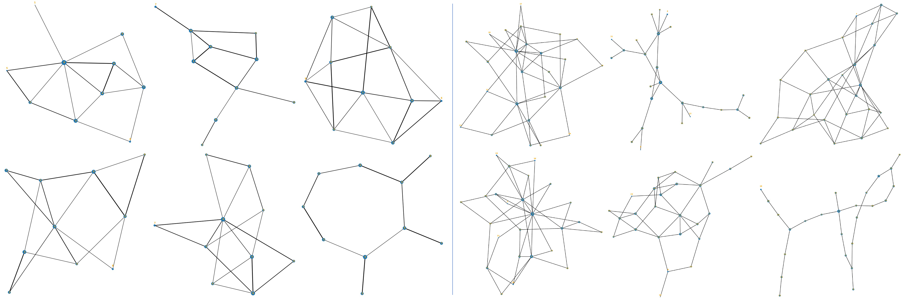
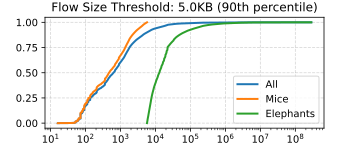
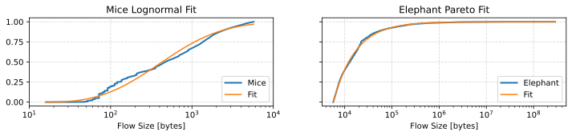
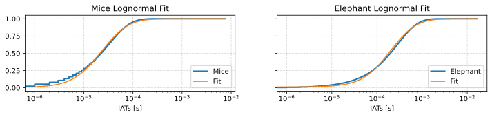
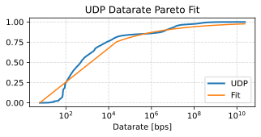
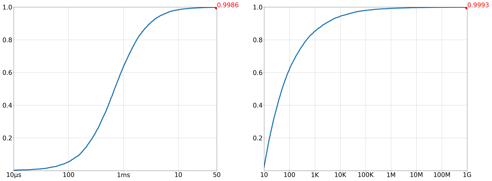

# Scenarios

Computer networks vary widely in their topology, traffic patterns, usage characteristics etc.
It is essential to provide diverse network conditions to effectively evaluate network protocols and routing algorithms,
but also to train ML-powered routing approaches that can be applied to more than just the 
specific network they were trained on. We call the entirety of these conditions a "network scenario".

PackeRL uses its `scenarios` module to generate versatile network scenarios (`scenarios.scenario.NetworkScenario`) 
consisting of:

- A network topology (a connected graph and configuration details like link capacities and delays),
- A list of events that can occur in the network at a predefined time, such as:
  - Link failures (consist of a failure time and the specific link that fails),
  - Traffic flow arrivals (consist of flow arrival time, flow size, e.g. TCP or UDP). 

For versatile network scenarios, we use configuration dictionaries that define the individual scenario 
generation/sampling parameters or provide presets for groups of such parameters. These presets and parameters are 
provided under `scenario_presets` and `scenario_custom_cfg` in the general PackeRL run config file, but default values
for generation parameters and parameter values grouped under presets can be found in `scenarios.presets`. 
In `scenarios.generator`, we find a `Generator` class that handles the generation/sampling of random network scenarios 
from the given configuration (individual parameters or unrolled presets). Where this configuration provides multiple
options or a range of options for a parameter, the generator will randomly sample a value for the parameter. 
For all random actions (parameter sampling, graph generation, event generation, random perturbation of values etc.), 
a random seed is used to ensure reproducibility of the generated scenarios. 
Practically, the list of events is split into `T` sub-lists (one for each time step in the simulation), 
where each sub-list contains all events that occur at that time step. This is because, in the simulation episode,
we transfer the upcoming events prior to the respective time step to the environment.

## Network Topologies

Network topology graphs are currently either generated randomly using NetworkX's random graph generators 
(Barabasi-Albert, Erdos-Renyi, Watts-Strogats), loaded from a file in the GraphML format (e.g. the Topology Zoo),
or they are pre-defined small topologies that are included in PackeRL and intended for testing purposes (e.g. `path3`).
Above graphic shows some examples of the random topology graphs generated by NetworkX (Left: 10 nodes, Right: 25 nodes)
The detailed parameters for the respective topology graph generation modes can be found in the
`scenarios.topology.graph` module.

A network topology, in addition to the graph itself, also contains configuration details such as per-link datarates,
and delays or a per-node "traffic potential". 
This information is often times not or only partially available from public datasets, and therefore we
supply our own method for generating these parameters in the `scenarios.topology.config` module based on node degree
and geographic centrality.

NOTE: as mentioned in [Section 03](03_network_model.md), we assume full-duplex symmetric peer-to-peer (P2P) connections, 
i.e. the link from node A to node B has the same capacity and delay as the link from node B to node A. 
This way, our generated topology graphs are undirected graphs. Yet, given that the packet buffer sizes are determined
individually for each direction, and given that traffic flows are always unidirectional, the topology graph becomes
a directed graph in the simulation (i.e. monitoring and routing decisions are always made for a specific direction).

NOTE 2: As opposed to Pytorch Geometric, NetworkX does support sparse graphs, in the sense that it does not require
contiguous node IDs. Therefore, when working on graphs in NetworkX, we generally use edge lists using the agent IDs
directly, instead of using a mapping from agent IDs to contiguous node IDs as required by Pytorch Geometric.

## Event Generation for Minimal Pilot Scenario

The pilot scenario contains a simple topology ([dot file](../data/scenario/topology/ring4bs.dot)) and traffic from a single source to a single destination ([traffic matrix](../data/scenario/events/tm/ring4_bs.txt)).
The datarate of the traffic between the source destination pair is equivalent to the bandwidth on the top path (nodes 0--1--3).
This scenario should show that PackeRL routes the traffic, so that the lower path is also used, thereby reducing overall congestion.

### Realistic Flow Data
We use flow data from flow-level information from a real-world trace.
The flow-level information (interarrival times, flow sizes, UDP datarates) was obtained from the [FlowStats](https://gitlab.kit.edu/benjamin.schichtholz/flowstats) tool, which was applied to the [CAIDA](https://www.caida.org/catalog/datasets/passive_dataset/) trace (equinix-nyc.dirB.20190117).

We differentiate between elephant and mice flows, because network traffic typically has heavy-tailed characteristics and large flows have inherently different statistical properties than mice flows.
An elephant flow exceeds a certain flow size (number of transmitted bytes) threshold, in our case the 90th percentile flow sizes, i.e. 5KB:

*Flow Size*
Now, the [FlowStats](https://gitlab.kit.edu/benjamin.schichtholz/flowstats) tool fits statistical distributions for flow sizes for both mice and elephant flows. (Parameters are stored in <../data/pilot/flowparams.json>)

*Interarrival Times*
Similarly, the [FlowStats](https://gitlab.kit.edu/benjamin.schichtholz/flowstats) tool fits statistical distributions for interarrival times for both mice and elephant flows. (Parameters are stored in <../data/pilot/flowparams.json>)

*UDP Datarate*
Similarly, the [FlowStats](https://gitlab.kit.edu/benjamin.schichtholz/flowstats) tool fits statistical distributions for UDP datarate, while the TCP datarate is adaptiva and changes during the simulation. (Parameters are stored in <../data/pilot/flowparams.json>)

### Event Sampling 
Having obtained the relevant parameters for each distribution (<../data/pilot/flowparams.json>), we now need to sample flows from these distributions.
For each new flow, we decide randomly whether it is a TCP or UDP flow. 
Then, we sample interarrival times and flow sizes for each flow.
For UDP flows, we additionally sample datarates.

In order to keep the simulation scalable (regarding computational resources and time), we limit the sampled flows to 1000s.
The interarrival time distribution can be shifted to the right with the scaling factor *interarrival\_time\_scaling* stored in <config/scenario/events/traffic/pilot_minimal.yaml> 
The flow size distribution can be shifted to the right with the scaling factor *flowsize\_scaling* stored in <config/scenario/events/traffic/pilot\_minimal.yaml>.

## Event Generation

The generation of scenario events naturally depends on the underlying network topology, so events are generated
after the topology graph has been generated.

### Traffic Flow Arrivals

We use a configurable log-logistic distribution for flow inter-arrival times and a configurable pareto distribution 
for flow sizes, inspired by Benson et al.:_"Network Traffic Characteristics of Data Centers in the Wild"_. 
We first sample inter-arrival times for every source-destination pair in the network (src!=dst), Using the nodes'
traffic potential to influence the inter-arrival time distribution. From the resulting inter-arrival times, 
we calculate the actual arrival times for each flow, which is the sum of all previous inter-arrival times.
Then, we sample flow sizes from the pareto distribution for every flow arrival and use random variables to determine
protocol and, for UDP, sending bitrate.

### Link Failures

We support two types of link failure generation methods:
- _Simple_ link failures require the number of failures, and spread them out evenly over the simulation time.
- _Weibull_ link failures use a Weibull distribution to sample failure times, which allows for more realistic failure 
  patterns (Bogle et al: _"TEAVAR: Striking the Right Utilization-Availability Balance in WAN Traffic Engineering"_).
  The distribution is parameterized by a scale and shape parameter, which can be configured in the scenario config.

For both types of link failures, we test every generated link failure for being a non-cut edge, and discard 
link failures that would turn the network graph into multiple disconnected components.
